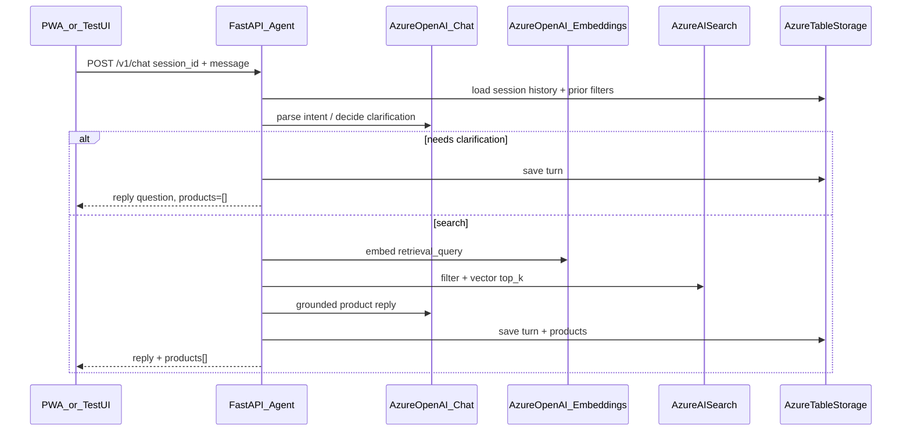

# Catalog Shopping Agent

Multi-turn fashion shopping assistant for the Figura PWA.

Users ask natural-language questions such as *“date night, something simple under 500 SEK”*. The agent clarifies when needed, retrieves products from **Azure AI Search** (vector + filters), and returns grounded product cards with images and prices.

**Live (Azure Container Apps, scale-to-zero):**  
https://ca-catalog-shopping-agent.redstone-093c1968.swedencentral.azurecontainerapps.io/

| Surface | URL |
|---|---|
| Test UI | `/` |
| OpenAPI | `/docs` |
| Health | `/v1/health` |
| Chat API | `POST /v1/chat` |

---

## What it does

1. **Intent parse** — budget, occasion, style, colors, garment type, gender  
2. **Clarify** — if the request is vague, ask one focused follow-up (no search yet)  
3. **Embed** — Azure OpenAI `text-embedding-3-small` (same model as the index)  
4. **Retrieve** — hybrid Azure AI Search (`products-vectors`): OData filters + vector KNN  
5. **Return cards** — `product_id`, name, price, currency, image (`source_url`), description  
6. **Remember** — multi-turn memory via `session_id` in **Azure Table Storage**

The agent does **not** call the vision enrichment model. Product images come from public CDN `source_url` on Search documents (not private blobs).



---

## Repository layout

```text
app/
  main.py                 # FastAPI app, CORS, static UI mount
  config.py               # pydantic-settings / env
  api/
    routes_chat.py        # /v1/chat, sessions
    routes_health.py      # /v1/health
  agent/
    orchestrator.py       # turn loop (clarify → retrieve → reply)
    intent.py             # structured intent + clarification guards
    prompts.py            # system prompts
  retrieval/
    embeddings.py         # query embeddings only
    search.py             # Azure AI Search hybrid query
    images.py             # URL normalize / overlay / gift-card filters
    hydrate.py            # optional Postgres hydrate
  memory/
    store.py              # Azure Table Storage sessions + messages
    session.py            # SessionRecord dataclass
  models/schemas.py       # request/response models
ui/index.html             # small test chat UI
tests/                    # unit + API tests (mocked Azure)
Dockerfile
.env.example
```

---

## Local development

### Prerequisites

- Python 3.12+
- Access to Azure AI Search + Azure OpenAI (chat + embeddings deployments)
- Azure Storage account with Table service (chat memory)

### Setup

```bash
python -m venv .venv
source .venv/bin/activate
pip install -r requirements.txt
cp .env.example .env
# fill secrets in .env — never commit .env
uvicorn app.main:app --reload --port 8000
```

- UI: http://127.0.0.1:8000/  
- Docs: http://127.0.0.1:8000/docs  
- Health: http://127.0.0.1:8000/v1/health  

### Tests

```bash
pytest -q
```

---

## API reference

### `POST /v1/chat`

Primary endpoint for the PWA.

**Request**

```json
{
  "message": "something nice",
  "session_id": null,
  "top_k": 5
}
```

| Field | Type | Notes |
|---|---|---|
| `message` | string | Required user utterance |
| `session_id` | uuid \| null | Omit/null to start a new conversation; reuse for multi-turn |
| `top_k` | int \| null | 1–10; default from `DEFAULT_TOP_K` (5) |

**Response**

```json
{
  "session_id": "a9e46b56-0186-483d-be6c-bd5d647803cf",
  "reply": "What type of clothing are you looking for?",
  "products": [],
  "filters_applied": {
    "price_max": null,
    "currency": null,
    "occasion": [],
    "garment_type": null,
    "retrieval_query": "nice clothing",
    "needs_clarification": true,
    "clarifying_question": "What type of clothing are you looking for?",
    "missing_slots": ["garment_type"]
  },
  "needs_clarification": true
}
```

When `needs_clarification` is `true`, `products` is empty — send the user’s answer with the **same** `session_id`.

When ready to search, response includes product cards:

```json
{
  "session_id": "...",
  "reply": "Here are a few options under 500 SEK…",
  "products": [
    {
      "product_id": "2054",
      "name": "dress kallvik black black",
      "brand": "",
      "price": 299.0,
      "currency": "SEK",
      "description": "...",
      "image": "https://...",
      "url": null,
      "category_path": "...",
      "score": 0.03
    }
  ],
  "filters_applied": { "...": "..." },
  "needs_clarification": false
}
```

### `GET /v1/sessions/{session_id}`

Returns saved messages + last applied filters for a session.

### `DELETE /v1/sessions/{session_id}`

Deletes the session and its messages (204).

### `GET /v1/health`

Connectivity checks for Table Storage, Azure AI Search, and Azure OpenAI. Optional Postgres hydrate is reported as skipped when unset.

---

## PWA integration

1. Call `POST /v1/chat` with the user message.  
2. Store returned `session_id` (per user/chat).  
3. On every follow-up (including answers to clarifying questions), send that `session_id`.  
4. Render `reply` as chat text; render `products[]` as cards (`image`, `name`, `price`, `currency`, optional `url`).  
5. If `needs_clarification` is true, show the question and wait for the next user message before expecting products.  
6. Set `CORS_ORIGINS` to your PWA origin(s) in production (or `*` for open testing).

Example:

```bash
curl -sS -X POST "$BASE/v1/chat" \
  -H 'Content-Type: application/json' \
  -d '{"message":"date night simple black dress under 500 SEK","top_k":5}'
```

---

## Environment variables

Copy from [`.env.example`](.env.example).

### Required

| Variable | Purpose |
|---|---|
| `AZURE_SEARCH_ENDPOINT` | Search service URL |
| `AZURE_SEARCH_QUERY_KEY` | Prefer **query** key (admin key also accepted) |
| `AZURE_SEARCH_INDEX_NAME` | `products-vectors` |
| `AZURE_OPENAI_ENDPOINT` | OpenAI resource |
| `AZURE_OPENAI_API_KEY` | OpenAI key |
| `AZURE_OPENAI_API_VERSION` | e.g. `2024-12-01-preview` |
| `AZURE_OPENAI_EMBEDDING_DEPLOYMENT` | `deploy-text-embedding-3-small-product-vectors` |
| `AZURE_OPENAI_EMBEDDING_DIMENSIONS` | `1536` |
| `AZURE_OPENAI_CHAT_DEPLOYMENT` | Chat deploy for intent + reply (**not** vision) |
| `AZURE_STORAGE_CONNECTION_STRING` | Table Storage connection string (local / most hosts) |

### Container Apps note

Connection strings contain `=` and `;`, which break Azure Container Apps `--secrets name=value` parsing. Production uses:

| Variable | Purpose |
|---|---|
| `AZURE_STORAGE_CONNECTION_STRING_B64` | Base64 of the full connection string |

The app prefers B64 when set (`resolved_storage_connection_string`).

### Optional

| Variable | Default | Purpose |
|---|---|---|
| `DATABASE_URL` | empty | Optional Postgres hydrate for `product_url` / extra images |
| `DEFAULT_TOP_K` | `5` | Default result count |
| `MAX_TOP_K` | `10` | Cap for `top_k` |
| `CHAT_HISTORY_LIMIT` | `12` | Messages loaded per turn |
| `CORS_ORIGINS` | localhost + `*` | Comma-separated or JSON list |
| `RATE_LIMIT_PER_MINUTE` | `60` | Per-IP chat rate limit |

### Not used by this agent

- Vision enrichment deployment  
- Blob account keys for catalog images (use CDN `source_url`)  
- Enrich worker settings (`ENRICH_*`, etc.)

---

## Retrieval behavior

- **Join key:** `product_id` = Search document key  
- **Vector field:** `content_vector` (1536-dim, cosine / HNSW)  
- **Filters:** price/currency, optional gender/garment; occasion/style/colors as collection `any()` when confident  
- **Occasion expand:** e.g. `date` → `date` \| `evening`  
- **Noise control:** drops gift cards / presentkort; skips overlay & private blob image URLs; normalizes broken double-`?` CDN URLs  
- **Soft fallback:** if strict filters return nothing, retries with looser filter sets  
- **Keyword query:** uses cleaned `retrieval_query` (no price numbers) so gift cards don’t match “500 SEK”

---

## Chat memory (Azure Table Storage)

Cheaper than Cosmos DB for this workload.

| Table | PartitionKey | RowKey | Payload |
|---|---|---|---|
| `chatsessions` | `session` | `{session_id}` | filters JSON, summary, timestamps |
| `chatmessages` | `{session_id}` | time-ordered id | role, content, products JSON |

The app creates tables on first use if missing.

---

## Azure deployment

Deployed as a **serverless Container App** (min replicas = 0) in resource group  
`rg-catalog-product-description-vector-enrichment` (Sweden Central).

Related resources (current):

| Resource | Name |
|---|---|
| Container App | `ca-catalog-shopping-agent` |
| Container Apps Environment | `cae-catalog-shopping-agent` |
| ACR | `acrcatagent9b25bd` |
| Table Storage | `stcatagent9b25bd` |
| Chat OpenAI deploy | `deploy-gpt-4.1-mini-catalog-agent` |
| Embedding deploy | `deploy-text-embedding-3-small-product-vectors` |
| Search index | `products-vectors` |

### Rebuild & update image

```bash
az acr build -r acrcatagent9b25bd -t catalog-shopping-agent:latest -f Dockerfile .

az containerapp update \
  -n ca-catalog-shopping-agent \
  -g rg-catalog-product-description-vector-enrichment \
  --image acrcatagent9b25bd.azurecr.io/catalog-shopping-agent:latest
```

### Local Docker

```bash
docker build -t catalog-shopping-agent .
docker run --env-file .env -p 8000:8000 catalog-shopping-agent
```

---

## Security

- Never commit `.env` or keys  
- Prefer a Search **query** key for the agent  
- Prefer Table Storage B64 secret on Container Apps  
- Prefer CDN `source_url` for images; do not expose private blob keys to the chat agent  
- Rotate any keys that were pasted into chat or logs  

---

## Acceptance checks

- [x] “black shirt under 400 SEK for a date” / “date night … under 500 SEK” returns relevant products when present  
- [x] Price/currency filters respected  
- [x] Vague prompts ask a clarifying question (`needs_clarification: true`)  
- [x] Multi-turn reuse of `session_id` merges prior filters  
- [x] Vision enrichment model is never called for retrieval  
- [x] Health reports Search + OpenAI + Table Storage OK on the deployed app  
